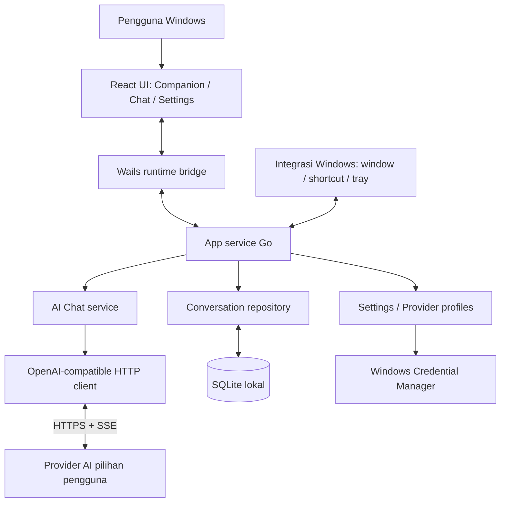

# 03 — Arsitektur Teknis

## 1. Tujuan arsitektur

Arsitektur harus cukup sederhana untuk MVP, tetapi tidak mencampur seluruh logika ke `main.go` atau komponen React. Batas utamanya adalah:

- **Frontend:** tampilan dan interaksi pengguna.
- **Backend Go:** komunikasi provider, stream, storage, dan operasi desktop.
- **OS/runtime:** WebView2 dan integrasi Windows.
- **Provider AI:** endpoint eksternal yang dipilih pengguna.

Tidak ada server localhost terpisah untuk MVP. Frontend berkomunikasi dengan fungsi Go melalui bridge Wails.

## 2. Diagram tingkat tinggi



## 3. Komponen

### 3.1 Frontend React

Tanggung jawab:
- Menampilkan mode pet, chat, daftar percakapan, dan settings.
- Mengelola state visual: draft, loading, streaming, selected conversation, error banner.
- Menerima event stream dari Go dan memperbarui tampilan.
- Meminta operasi melalui fungsi backend yang dibinding oleh Wails.
- Melakukan validasi ringan untuk UX; validasi keamanan tetap di backend.

Tidak bertanggung jawab untuk:
- Membuat request API provider secara langsung.
- Membaca/menulis file database secara langsung.
- Menyimpan API key dalam localStorage/sessionStorage.
- Menjalankan shell/command.

### 3.2 App service (`app.go` atau package aplikasi)

Fungsi ini menjadi facade yang diikat ke Wails. Hindari menjadikan facade sebagai tempat semua logika.

Tanggung jawab:
- Menyediakan method seperti `ListProviders`, `SaveProvider`, `SetActiveProvider`, `ListConversations`, `SendMessage`, `CancelGeneration`, dan `GetSettings`.
- Memvalidasi masukan dan meneruskan ke service yang tepat.
- Emit event UI melalui runtime Wails.
- Menangani lifecycle request dan shutdown.

### 3.3 AI service

Tanggung jawab:
- Menyiapkan request Chat Completions.
- Mengubah model pesan internal ke format API.
- Memulai HTTP request dengan context cancellation.
- Membaca SSE stream dan menghasilkan event terstruktur.
- Mengubah HTTP/protocol error menjadi tipe error internal.
- Tidak mengetahui detail presentasi UI.

### 3.4 Storage

Tanggung jawab:
- Mengelola koneksi SQLite, schema version, transaksi, dan repository.
- Menyimpan conversation, message, model/provider metadata nonrahasia, dan user settings.
- Tidak menyimpan API key dalam tabel.

### 3.5 Windows platform adapter

Tanggung jawab:
- Fitur window jika didukung: ukuran, posisi, frameless, always-on-top, show/hide.
- Global hotkey, tray, dan startup jika sudah masuk scope.
- Menyembunyikan detail API platform di balik interface/paket kecil.

Jangan memasukkan kode Win32 ke UI React. Jika native integration belum stabil, buat fallback yang terlihat jelas dan jangan membuat tombol yang tidak berfungsi.

## 4. Pola jendela

### Keputusan awal

Gunakan **satu WebView/jendela** yang berganti antara:
- `pet`: ukuran kecil, frameless, latar transparan jika stabil.
- `chat`: panel ukuran lebih besar, input dan riwayat chat.
- `settings`: panel konfigurasi.

Keuntungan: penggunaan resource dan lifecycle lebih sederhana, tidak ada sinkronisasi antarbeberapa WebView, serta tidak perlu menangani dua frontend state terpisah.

### Risiko yang wajib dibuktikan

Windows/WebView2 tidak otomatis menjamin perilaku “pixel-perfect transparent click-through” untuk window berbentuk karakter. Jendela native biasanya mempunyai bounds persegi panjang; piksel UI yang terlihat transparan belum tentu meneruskan klik ke aplikasi di belakangnya. Karena itu:

1. Buat spike minimal transparansi + frameless + drag + resize di Windows.
2. Uji always-on-top dan pemulihan posisi.
3. Tentukan apakah area kosong harus meneruskan klik atau cukup karakter memiliki bounds ketat.
4. Bila tidak layak, kurangi transparansi atau gunakan ukuran window ketat di sekitar karakter. Jangan mengubah ke banyak window tanpa mencatat trade-off.

## 5. Alur mengirim pesan

1. Frontend memanggil `SendMessage(conversationID, text, providerID)`.
2. Backend memvalidasi conversation, provider aktif, batas panjang, dan tidak ada generation yang konflik.
3. Backend membuat message pengguna dengan status awal yang sesuai dan menyimpannya.
4. Backend membuat `context.WithCancel` untuk generation serta menghubungkan ID request dengan cancel function.
5. AI client membuat HTTP request ke endpoint yang sudah dinormalisasi.
6. Jika HTTP error, backend mengirim event/status error tanpa membocorkan secret.
7. Jika streaming, parser SSE membaca `data:` frame, melewati komentar/keepalive, mengenali `[DONE]`, dan memproses error yang dikirim server.
8. Backend emit event terstruktur, contohnya `chat:delta`, `chat:complete`, `chat:error`, `chat:cancelled`.
9. Frontend menambahkan delta ke pesan asisten yang tepat menggunakan request ID.
10. Setelah selesai/cancel/error, backend menyimpan hasil dan status final, lalu membersihkan cancel function.

**Penting:** satu event harus mencantumkan ID conversation, message, dan generation/request agar delta yang terlambat tidak masuk ke chat yang salah.

## 6. Event contract

Nama event awal (dapat disesuaikan, tetapi dokumentasikan satu versi final):

- `chat:started`
- `chat:delta`
- `chat:completed`
- `chat:failed`
- `chat:cancelled`
- `provider:test-result`

Payload `chat:delta` contoh:

```json
{
  "requestId": "uuid",
  "conversationId": "uuid",
  "messageId": "uuid",
  "delta": "teks baru"
}
```

Jangan mengirim API key, header authorization, seluruh object HTTP request, atau stack trace internal ke event UI.

## 7. Model pesan internal

```go
type MessageRole string

const (
    RoleSystem    MessageRole = "system"
    RoleUser      MessageRole = "user"
    RoleAssistant MessageRole = "assistant"
)

type MessageStatus string

const (
    StatusPending   MessageStatus = "pending"
    StatusStreaming MessageStatus = "streaming"
    StatusComplete  MessageStatus = "complete"
    StatusCancelled MessageStatus = "cancelled"
    StatusFailed    MessageStatus = "failed"
)
```

Cuplikan ini ilustrasi kontrak, bukan kode final. Validasi role, ID, timestamp, dan panjang isi tetap diperlukan.

## 8. Batas konteks

Jangan kirim seluruh riwayat tanpa batas. Sebelum request:

- Ambil system instruction aplikasi jika memang ada; jangan memberi pengguna kesan bahwa itu instruction rahasia milik provider.
- Tambahkan pesan dari percakapan aktif secara kronologis.
- Terapkan batas konteks berdasarkan jumlah pesan atau estimasi token yang dapat dikonfigurasi.
- Selalu pertahankan pesan terbaru dan konsistensi role; jika perlu memangkas, pilih strategi yang eksplisit.
- Jangan mengklaim jumlah token akurat bila tidak memakai tokenizer yang sesuai model.
- Batas output merupakan pengaturan optional karena parameter provider berbeda-beda.

## 9. Error model internal

Buat error internal yang dapat dipetakan ke pesan UI, misalnya:

- `ErrNoActiveProvider`
- `ErrInvalidProviderConfig`
- `ErrCredentialUnavailable`
- `ErrUnauthorized`
- `ErrForbidden`
- `ErrModelNotFound`
- `ErrRateLimited`
- `ErrProviderServer`
- `ErrNetwork`
- `ErrTimeout`
- `ErrStreamProtocol`
- `ErrCancelled`
- `ErrStorage`

Simpan status code provider dan request ID bila aman. Jangan tampilkan raw body yang mungkin mengandung detail sensitif tanpa sanitasi.

## 10. Lifecycle dan concurrency

- Setiap generation mempunyai cancellation context sendiri.
- Shutdown aplikasi membatalkan request aktif dan menutup resource.
- Batasi satu generation aktif per conversation pada MVP agar state sederhana.
- Tentukan kebijakan saat pengguna pindah percakapan sementara generation berlangsung: generation tetap berjalan dan update disimpan ke conversation asal, atau dibatalkan dengan konfirmasi. Pilihan default yang direkomendasikan: **tetap berjalan** dan event mengarah ke conversation/request ID yang tepat.
- Jangan memegang database lock selama jaringan berlangsung.
- Hindari goroutine yang tidak punya jalur berhenti.

## 11. Performa

- Jangan polling provider atau update UI saat idle.
- Gabungkan delta kecil menjadi batch singkat bila render terlalu sering, tetapi jangan menambah delay yang mengganggu.
- Pakai pagination/limit untuk daftar riwayat jika jumlahnya tumbuh.
- Ukur seluruh proses WebView2, bukan hanya proses utama Wortel AI.
- Gunakan asset karakter kecil dan lokal; jangan fetch gambar dari internet untuk animasi utama.

## 12. Deployment/update

Pada MVP, distribusi boleh berupa executable portable. Installer merupakan tahap berikutnya. Update otomatis, telemetry, dan updater service tidak perlu dimasukkan sampai mekanisme penandatanganan, rollback, dan verifikasi integritas diputuskan.
